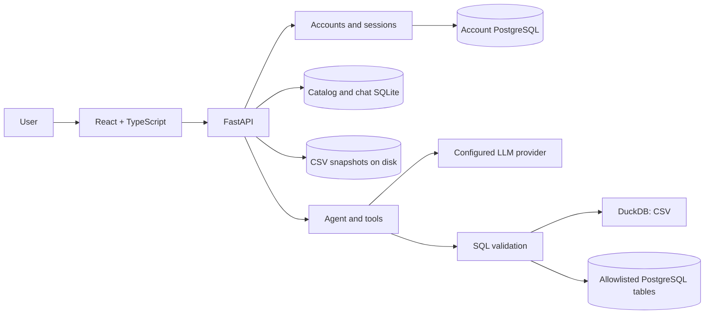

<p align="center"><a href="README.md">🇷🇺 Русский</a> · <a href="README.en.md">🇬🇧 English</a></p>

<p align="center"></p>
<h1 align="center">EVIA</h1>
<p align="center"><strong>An AI assistant for exploring data and preparing analytical reports</strong></p>
<p align="center">CSV and PostgreSQL · natural-language questions · charts · dashboards · PDF</p>
<p align="center">
  
  
  
  
</p>
<p align="center"><a href="https://evia-production.up.railway.app/"><strong>Open EVIA</strong></a> · <a href="docs/guide/EXPERT_GUIDE.en.md">Expert guide</a> · <a href="docs/guide/ARCHITECTURE.en.md">Architecture</a> · <a href="docs/guide/DEFENSE.en.md">Defense guide</a></p>


> Screenshots show the Russian-language interface in an isolated browser test with synthetic data and the `mock` provider. They do not establish real-model quality or imply that an English UI is available.

## Contents

- [About](#about)
- [Capabilities](#capabilities)
- [Working with data](#working-with-data)
- [Chat, results and visualizations](#chat-results-and-visualizations)
- [Dashboards and PDF](#dashboards-and-pdf)
- [Architecture](#architecture)
- [Security and limitations](#security-and-limitations)
- [Setup and configuration](#setup-and-configuration)
- [Testing](#testing)
- [Repository structure](#repository-structure)
- [Documentation and roadmap](#documentation-and-roadmap)

## About

EVIA helps people explore tabular data without writing every SQL query themselves. A user uploads a CSV file or selects a preconfigured PostgreSQL table, inspects its structure and quality, asks Evia questions, and reviews computed results. Charts can be saved in dashboards and selected findings can be included in a PDF report.

**EVIA assists an analyst; it does not replace their judgment.** Language-model answers can be wrong. Check the fields, SQL, scope and returned data before using a result to make a decision. Availability depends on the source, server configuration and model provider.

## Capabilities

| Scenario | Current behavior |
| --- | --- |
| CSV | File upload, import information, original-file versions and reimport. UTF-8, UTF-16 and Windows-1251 are supported; the upload limit is 512 MiB. |
| PostgreSQL | Direct read access to allowlisted tables. An administrator configures the connection and table list on the server. |
| Data profile | Schema, field types, preview rows, missing values, distributions and available statistics. The interface indicates the calculation scope. |
| AI chat | Questions, saved conversation history, follow-ups, tool results and SQL where returned. |
| Charts | Tables, KPI, line, bar, pie and other supported cards, depending on the data and result. |
| Dashboards | Save and reopen computed charts, reorder cards and explicitly refresh the data. |
| Report | Source structure, sample rows, available quality information, a preview-based chart and selected EVIA answers; save through the browser's print-to-PDF dialog. |
| Account | Email/password registration and sign-in, profile, photo and password recovery when email delivery is configured. |

## Working with data

1. Sign in and select **«Добавить CSV»** (Add CSV). The synthetic [`sample-data/sales.csv`](sample-data/sales.csv) is suitable for a demonstration; do not upload confidential data without authorization.
2. Select a source in the sidebar. **«Обзор»** (Overview), **«Столбцы»** (Columns), **«Качество»** (Quality), **«Данные»** (Data) and **«Схема»** (Schema) expose different views of the dataset.
3. Compare inferred types and missing values with the original. Preview rows are limited and do not necessarily represent the whole dataset. A profile can cover the full source or a sample.

<table><tr>
<td width="50%"></td>
<td width="50%"></td>
</tr><tr><td>Columns and types</td><td>Data quality</td></tr></table>


The first CSV row must contain unique column names. Supported delimiters are comma, semicolon, tab and vertical bar. PostgreSQL requires server-side `POSTGRES_DSN` and `POSTGRES_ALLOWED_TABLES`; the UI does not provide arbitrary database connection setup in the browser. [PostgreSQL setup](docs/postgresql-source.md) (Russian).

## Chat, results and visualizations

Select a source and ask a question in the right-hand panel. For example:

- «Какие столбцы есть в источнике?» — Which columns are available?
- «Покажи первые строки» — Show the first rows.
- «Какая сумма revenue?» — What is the sum of `revenue`, if that numeric field exists?
- «Построй график выручки по месяцам» — Chart revenue by month, if suitable fields exist.

Open the answer's result to inspect a table, chart, SQL and calculation details when available. Check the fields and data scope. A plausible model response alone does not prove that a calculation was executed. History is associated with a source and user; saved results can be reopened.


The model may propose query parameters or call tools. The server validates inputs and restrictions; DuckDB executes CSV calculations, while PostgreSQL has a separate read-only path. Hypothesis tools support group comparison and relationship analysis with suitable inputs. Correlation does not establish causation.

## Dashboards and PDF

EVIA can display generated charts and save dashboards. A saved result opens without rerunning the calculation; refresh explicitly requests new results. A CSV result can be marked stale after a source change. Changes to PostgreSQL rows without a schema change are not always detected automatically. [Saved dashboard behavior](docs/saved-dashboard-snapshots.md) (Russian).

From the source overview choose **«Собрать PDF-отчёт»** (Build PDF report). Select successful EVIA answers if available, then choose **«Сохранить в PDF»** to open the browser's print dialog. The report includes source information, fields, first rows, available quality information and selected answers with returned details. A source-overview pie chart, when available, is calculated from preview rows; truncated results are identified.


## Architecture



The React app communicates with FastAPI on the same site. When authentication is enabled, accounts and sessions are stored in PostgreSQL; catalog, history and CSV originals use configured persistent storage. `mock`, Ollama and OpenAI-compatible APIs are configurable, including Cloud.ru when configured. The deployed model name and availability depend on the environment.

[Architecture guide](docs/guide/ARCHITECTURE.en.md) · [API contracts](contracts/README.md) · [SQL executor](docs/safe-sql-executor.md) (Russian)

## Security and limitations

- Passwords are hashed with Argon2; access to user-owned sources, chats and dashboards is enforced server-side. Profile photos are stored in PostgreSQL; secrets belong in server-side configuration.
- Source queries are restricted to read-only operations and validated. PostgreSQL should use a separate least-privilege account. Result size and execution time are bounded.
- Password recovery requires a configured email provider. [Account setup](docs/ACCOUNT_SETUP.md) (Russian).
- An arbitrary question is not guaranteed to produce correct SQL or a complete dashboard on the first attempt. Inspect the answer and its limits.
- A preview chart is not necessarily a distribution of the entire source. Reopening a saved result does not mean it was refreshed.
- The overview and PDF currently count empty strings and `NULL` differently, so quality figures may disagree. See [issue #152](https://github.com/VsevolodCod/EVIA/issues/152).
- Network, model, email-provider and storage availability affect the service. Prepare a synthetic dataset and saved result before a demonstration.
- `mock` is for integration checks and demonstration responses, not for evaluating a real model.

## Setup and configuration

Requirements: Python 3.11+ and Node.js 22.12+ with npm. From the repository root:

```bash
git clone https://github.com/VsevolodCod/EVIA.git
cd EVIA
python3 -m venv .venv
source .venv/bin/activate
python -m pip install -r requirements.txt
npm ci --prefix frontend
npm --prefix frontend run build
LLM_PROVIDER=mock python scripts/run.py
```

Open `http://127.0.0.1:8000`; API documentation is at `/docs`. This is a local demonstration mode; a real model and authentication need separate configuration. For frontend development use `python scripts/run.py --dev`. On Windows use `.venv\Scripts\python` and `npm.cmd`.

| Group | Main variables |
| --- | --- |
| LLM | `LLM_PROVIDER`, `LLM_MODEL`, `OPENAI_BASE_URL`, `OPENAI_API_KEY`, `OLLAMA_BASE_URL`, `TIMEOUT`, `MAX_TOKENS_G`, `AGENT_MAX_STEPS` |
| Files and history | `BI_DATA_DIR`, `CATALOG_DB_PATH`, `CHAT_DB_PATH` |
| PostgreSQL source | `POSTGRES_DSN`, `POSTGRES_ALLOWED_TABLES`, connection and statement timeouts |
| Accounts | `AUTH_ENABLED`, `AUTH_DATABASE_URL`, `AUTH_SECRET`, optional bootstrap settings |
| Recovery | `BREVO_API_KEY` and `BREVO_SENDER_EMAIL`, or `RESEND_API_KEY` and `MAIL_FROM` |

See [`.env.example`](.env.example). Store server keys and passwords only in environment secrets. On Railway configure persistent storage and the account database; see [account setup](docs/ACCOUNT_SETUP.md) and the [Dockerfile](Dockerfile).

## Testing

```bash
npm --prefix frontend test
npm --prefix frontend run build
python -m pytest -q
```

Browser tests require `requirements-browser.txt` and Chromium: `BI_BROWSER_TESTS=1 python -m pytest tests/browser -q`. They start an isolated server and use synthetic data. Check [GitHub Actions](https://github.com/VsevolodCod/EVIA/actions) for the current status: the existence of tests does not mean that every check passes on the current commit.

<table><tr>
<td width="50%"></td>
<td width="50%"></td>
</tr><tr><td>Phone overview</td><td>Charts after scrolling</td></tr></table>

## Repository structure

```text
app/                  FastAPI, agent, authentication, sources, SQL, charts and hypotheses
frontend/             React + TypeScript UI and frontend tests
contracts/            contract schemas and examples
sample-data/          small synthetic CSV
scripts/              launchers, verification and benchmarks
tests/                backend and browser tests
docs/                 guides, architecture, limitations and decision history
```

## Documentation and roadmap

- [Expert guide](docs/guide/EXPERT_GUIDE.en.md) — what to click and verify.
- [EVIA architecture](docs/guide/ARCHITECTURE.en.md) — components, storage, boundaries and request flow.
- [Defense questions and answers](docs/guide/DEFENSE.en.md) — demo, limitations and checklist.
- [GitHub backlog](https://github.com/VsevolodCod/EVIA/issues) — open work and its status.
- [October 30 demo plan](docs/final-demo-2026-10-30.md) — a historical rehearsal plan; recheck before presenting.

The repository currently has no root `LICENSE` file; the team must agree on distribution terms. Team membership and roles should be confirmed by the participants.
