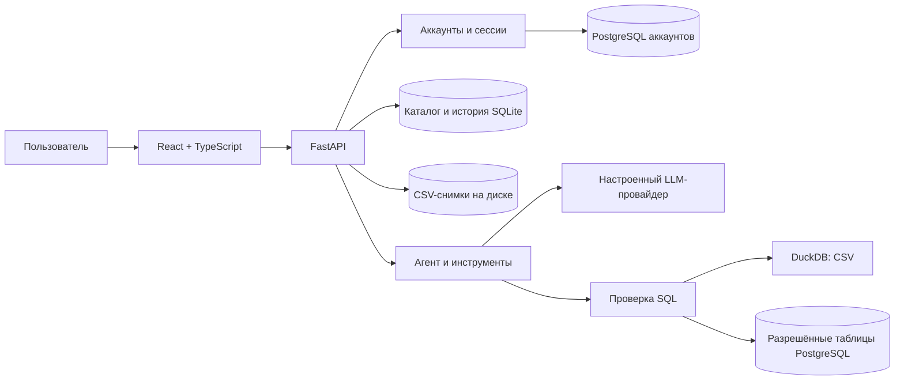

<p align="center"><a href="README.md">🇷🇺 Русский</a> · <a href="README.en.md">🇬🇧 English</a></p>

<p align="center"></p>
<h1 align="center">EVIA</h1>
<p align="center"><strong>AI-помощник для исследования данных и подготовки аналитических отчётов</strong></p>
<p align="center">CSV и PostgreSQL · вопросы на естественном языке · графики · дашборды · PDF</p>
<p align="center">
  
  
  
  
</p>
<p align="center"><a href="https://evia-production.up.railway.app/"><strong>Открыть EVIA</strong></a> · <a href="docs/guide/EXPERT_GUIDE.md">Руководство эксперта</a> · <a href="docs/guide/ARCHITECTURE.md">Архитектура</a> · <a href="docs/guide/DEFENSE.md">Подготовка к защите</a></p>


Снимки ниже сделаны в изолированном браузерном тесте с синтетическими данными и `mock`-провайдером. Они показывают интерфейс, но не подтверждают качество реальной модели.

## Содержание

- [О проекте](#о-проекте)
- [Возможности](#возможности)
- [Работа с данными](#работа-с-данными)
- [Чат, результаты и визуализации](#чат-результаты-и-визуализации)
- [Дашборды и PDF](#дашборды-и-pdf)
- [Архитектура](#архитектура)
- [Безопасность и ограничения](#безопасность-и-ограничения)
- [Запуск и конфигурация](#запуск-и-конфигурация)
- [Проверки](#проверки)
- [Структура проекта](#структура-проекта)
- [Документация и развитие](#документация-и-развитие)

## О проекте

EVIA помогает исследовать табличные данные без необходимости самостоятельно писать каждый SQL-запрос. Пользователь загружает CSV или выбирает заранее настроенную PostgreSQL-таблицу, смотрит состав и качество данных, задаёт вопросы Эвии и изучает рассчитанные результаты. На их основе можно строить графики, сохранять дашборды и подготавливать PDF-отчёт.

**EVIA — помощник аналитика.** Ответ языковой модели может содержать ошибку; проверяйте поля, SQL, охват и данные результата перед принятием решения. Готовность отдельного сценария зависит от выбранного источника, конфигурации и доступности провайдера модели.

## Возможности

| Сценарий | Что доступно |
| --- | --- |
| CSV | Загрузка файла, информация об импорте, версии исходного файла и повторный импорт. Поддерживаются UTF-8, UTF-16 и Windows-1251; предел загрузки — 512 МиБ. |
| PostgreSQL | Чтение разрешённых таблиц напрямую. Подключение и список таблиц задаёт администратор на сервере. |
| Профиль | Схема, типы полей, первые строки, пропуски, распределения и доступная статистика. Область расчёта указывается интерфейсом. |
| AI-чат | Вопросы о данных, сохранённая история, уточнения, результаты инструментов и SQL там, где они возвращены. |
| Графики | Таблицы, KPI, линейные, столбчатые, круговые и другие доступные типы карточек; применимость зависит от данных и результата. |
| Дашборды | Сохранение и повторное открытие рассчитанных графиков, изменение порядка карточек и явное обновление данных. |
| Отчёт | Состав источника, пример строк, доступные сведения о качестве, диаграмма по предпросмотру и выбранные ответы EVIA; сохранение через печать браузера в PDF. |
| Учётная запись | Регистрация и вход по email и паролю, профиль, фото и восстановление пароля при настроенной доставке писем. |

## Работа с данными

1. Войдите в аккаунт и нажмите **«Добавить CSV»**. Для демонстрации подойдёт [`sample-data/sales.csv`](sample-data/sales.csv); не загружайте конфиденциальные данные без разрешения.
2. Выберите источник в левой панели. Вкладки **«Обзор»**, **«Столбцы»**, **«Качество»**, **«Данные»** и **«Схема»** показывают разные стороны набора данных.
3. Сверяйте типы и пропуски с исходным файлом. Предпросмотр содержит ограниченное число строк; он не всегда равен всему набору. Профиль может относиться ко всему источнику или к выборке.

<table><tr>
<td width="50%"></td>
<td width="50%"></td>
</tr><tr><td>Столбцы и типы</td><td>Качество данных</td></tr></table>


Для CSV первая строка должна содержать уникальные имена столбцов. Доступные разделители: запятая, точка с запятой, табуляция и вертикальная черта. Для PostgreSQL проверьте, что администратор настроил `POSTGRES_DSN` и `POSTGRES_ALLOWED_TABLES`; форма не является универсальным подключением к произвольной базе из браузера. [Подробнее о PostgreSQL](docs/postgresql-source.md).

## Чат, результаты и визуализации

Выберите источник и задайте вопрос в правой панели, например:

- «Какие столбцы есть в источнике?»
- «Покажи первые строки».
- «Какая сумма revenue?» — если в данных есть числовое поле `revenue`.
- «Построй график выручки по месяцам» — если доступны соответствующие поля.

Откройте результат ответа: там могут быть таблица, график, SQL и дополнительные сведения о расчёте. Проверяйте, к каким строкам и полям относится результат. Успешный текст модели сам по себе не доказывает, что расчёт выполнен. История привязана к источнику и пользователю; ранее сохранённые результаты можно открыть повторно.


Модель может предложить параметры запроса или вызвать инструменты. Сервер проверяет входные данные и ограничения; вычисления по CSV выполняет DuckDB, а запросы к PostgreSQL проходят через отдельный read-only путь. Проверка гипотез включает сравнение групп и анализ связи при подходящих входных данных. Корреляция не доказывает причинность.

## Дашборды и PDF

EVIA умеет показывать созданные графики и сохранять дашборды. Сохранённый результат открывается без повторного вычисления; кнопка обновления запрашивает новый расчёт. Если данные CSV изменились, результат может быть помечен как устаревший. Для PostgreSQL изменение строк без изменения схемы не всегда обнаруживается автоматически. [Как хранятся результаты](docs/saved-dashboard-snapshots.md).

В обзоре источника нажмите **«Собрать PDF-отчёт»**. При наличии успешных ответов выберите нужные расчёты и нажмите **«Сохранить в PDF»** — откроется печать браузера. В документ входят сведения об источнике, поля, первые строки, доступный профиль качества и выбранные ответы с возвращёнными деталями. Круговая диаграмма обзора, если построена, рассчитана по доступным строкам предпросмотра; усечённые результаты отмечаются.


## Архитектура



React-приложение работает с FastAPI через API одного сайта. Учётные записи и сессии при включённой авторизации хранятся в PostgreSQL; каталог, история и исходные CSV используют настроенное постоянное хранилище. LLM выбирается настройками сервера: доступны `mock`, Ollama и OpenAI-совместимый API, в том числе при соответствующей настройке Cloud.ru. Имя и доступность модели зависят от развёртывания.

[Подробная архитектура](docs/guide/ARCHITECTURE.md) · [API и контракты](contracts/README.md) · [Безопасный SQL](docs/safe-sql-executor.md)

## Безопасность и ограничения

- Пароли хешируются Argon2; доступ к пользовательским источникам, чатам и дашбордам проверяется сервером. Фото профиля хранится в PostgreSQL; секреты не помещаются во frontend или репозиторий.
- Запросы к источникам ограничены чтением и проверяются; настройки PostgreSQL должны использовать отдельную учётную запись с минимальными правами. Результаты и время исполнения ограничены.
- Восстановление пароля работает при настроенном почтовом провайдере. [Настройка аккаунтов](docs/ACCOUNT_SETUP.md).
- Не каждый свободный вопрос гарантированно приведёт к корректному SQL или полноценному дашборду с первой попытки. Проверьте ответ и ограничения результата.
- График по предпросмотру не следует выдавать за распределение по всему источнику. Открытие сохранённого результата не означает, что данные пересчитаны.
- Обзор и PDF пока по-разному учитывают пустые строки и `NULL`; показатели качества могут расходиться. См. [задачу #152](https://github.com/VsevolodCod/EVIA/issues/152).
- Зависимости от сети, модели, почтового провайдера и свободного места на хранилище влияют на доступность. Для демонстрации полезно заранее подготовить синтетический источник и сохранённый результат.
- `mock` предназначен для проверки интеграции и демонстрационных ответов, а не для оценки качества реальной модели.

## Запуск и конфигурация

Нужны Python 3.11+ и Node.js 22.12+ с npm. Пример запуска из корня проекта:

```bash
git clone https://github.com/VsevolodCod/EVIA.git
cd EVIA
python3 -m venv .venv
source .venv/bin/activate
python -m pip install -r requirements.txt
npm ci --prefix frontend
npm --prefix frontend run build
LLM_PROVIDER=mock python scripts/run.py
```

Откройте `http://127.0.0.1:8000`; документация API — `/docs`. Это локальный демонстрационный режим; для реальной модели и авторизации нужны отдельные настройки. Разработка интерфейса: `python scripts/run.py --dev`. Для Windows используйте `.venv\Scripts\python` и `npm.cmd`.

| Группа | Основные переменные |
| --- | --- |
| LLM | `LLM_PROVIDER`, `LLM_MODEL`, `OPENAI_BASE_URL`, `OPENAI_API_KEY`, `OLLAMA_BASE_URL`, `TIMEOUT`, `MAX_TOKENS_G`, `AGENT_MAX_STEPS` |
| Файлы и история | `BI_DATA_DIR`, `CATALOG_DB_PATH`, `CHAT_DB_PATH` |
| PostgreSQL-источник | `POSTGRES_DSN`, `POSTGRES_ALLOWED_TABLES`, таймауты соединения и запроса |
| Учётные записи | `AUTH_ENABLED`, `AUTH_DATABASE_URL`, `AUTH_SECRET`, настройки bootstrap при необходимости |
| Восстановление | `BREVO_API_KEY` и `BREVO_SENDER_EMAIL` либо `RESEND_API_KEY` и `MAIL_FROM` |

Пример находится в [`.env.example`](.env.example); серверные ключи и пароли храните только в секретах окружения. Для Railway проверьте постоянный volume и настройки БД аккаунтов; см. [настройку аккаунтов](docs/ACCOUNT_SETUP.md) и [Dockerfile](Dockerfile).

## Проверки

```bash
npm --prefix frontend test
npm --prefix frontend run build
python -m pytest -q
```

Браузерные тесты требуют зависимостей из `requirements-browser.txt` и Chromium: `BI_BROWSER_TESTS=1 python -m pytest tests/browser -q`. Они создают изолированный сервер и используют синтетические данные. Последнее состояние CI следует смотреть в [GitHub Actions](https://github.com/VsevolodCod/EVIA/actions): наличие тестов не означает, что все проверки текущего коммита проходят.

<table><tr>
<td width="50%"></td>
<td width="50%"></td>
</tr><tr><td>Обзор на телефоне</td><td>Графики после прокрутки</td></tr></table>

## Структура проекта

```text
app/                  FastAPI, агент, авторизация, источники, SQL, графики и гипотезы
frontend/             React + TypeScript, интерфейс и frontend-тесты
contracts/            схемы и примеры контрактов
sample-data/          небольшой синтетический CSV
scripts/              запуск, проверки и бенчмарки
tests/                backend и браузерные тесты
docs/                 руководства, архитектура, ограничения и история решений
```

## Документация и развитие

- [Пошаговое руководство эксперта](docs/guide/EXPERT_GUIDE.md) — что нажать и что проверить.
- [Архитектура EVIA](docs/guide/ARCHITECTURE.md) — компоненты, хранение, границы и поток запроса.
- [Вопросы и ответы к защите](docs/guide/DEFENSE.md) — краткий сценарий, ограничения и чек-лист.
- [Текущий backlog GitHub](https://github.com/VsevolodCod/EVIA/issues) — открытые задачи и их состояние.
- [Сценарий демонстрации от 30 октября](docs/final-demo-2026-10-30.md) — исторический план репетиции; перепроверяйте перед показом.

В репозитории пока нет корневого файла `LICENSE`; условия распространения необходимо согласовать с командой. Состав команды и роли следует указывать после подтверждения участниками.
