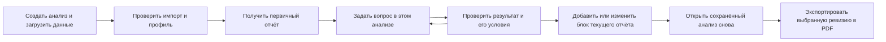

# EVIA: единая спецификация продукта

Версия 1.0 · 26 октября 2026 · **проект для командного review**.

Это рабочая основа разработки: какой продукт собираем, как им пользуются, как
соединяются функции и по каким признакам принимается результат. Решения ниже
предлагаются к принятию командой; они не означают, что описанные функции уже готовы.
После согласования изменения продуктового поведения сначала отражаются здесь,
затем в контрактах, задачах и реализации. README и экспертный гайд для итоговой
поставки готовятся по принятому и проверенному поведению на заключительном этапе.

Сверенная база кода: `main@4958fa44ae3aaa61f6f97044658c09dbb9099009`.
Натурная проверка выполнена ранее на PR #95, `8fbb3f3095fe6c97268c6afd6bad0e93febe9ace`,
с базой `199f48d` и исправлением маршрутизации обзора/уточнений. Теперь #95 принят
в main. Последующие #96–#99 сверены по коду; этот документ не выдаёт их за повторно
протестированные на модели.
GitHub-статусы приведены на дату документа и не являются подтверждением приёмки.
Ссылки на проверенные версии: [main](https://github.com/VsevolodCod/EVIA/tree/4958fa44ae3aaa61f6f97044658c09dbb9099009),
[PR #95](https://github.com/VsevolodCod/EVIA/pull/95).

Для обсуждения продуктового поведения сначала прочитайте разделы 3–6 и 13.
Разделы 7–8 фиксируют фактическое состояние; 9–12 задают архитектуру, порядок работ
и критерии приёмки. Это одна спецификация, а не новый комплект финальных инструкций.

## 1. Зачем нужен продукт

EVIA помогает аналитику и руководителю превратить незнакомые табличные данные
в проверяемый анализ и понятный отчёт: загрузить исходные данные, понять их качество,
задать вопросы, проверить гипотезы, выбрать выводы и представить результат коллегам.

Основная единица работы пользователя — **анализ**. Его видимый результат — отчёт
с выбранными показателями, таблицами, графиками и пояснениями. Чат управляет анализом
и помогает исследованию. Модель предлагает действия и объяснения; числа вычисляет
backend по указанным данным и условиям.

Обещание пользователю: «Загрузите данные, получите первичный обзор, уточните анализ
в диалоге и соберите отчёт, который можно открыть снова и экспортировать».

Готовность определяется всем этим путём. Наличие SQL-исполнителя, кнопки PDF или
сохранённой конфигурации графика по отдельности ещё не означает готовность отчёта.

## 2. Обязательства и границы

Основание: кейс «AI-Native BI Система», командная переписка от 25 октября,
десять сценариев заказчика, действующий backlog и проверка продукта.

| Обязательство | Решение для EVIA |
|---|---|
| Незнакомые сырые CSV, произвольные схемы | Импорт и типизация внутри продукта, сохранение оригинала/ID/версий, отчёт о потерях и ошибках |
| Прямое подключение PostgreSQL **или** ClickHouse | Довести имеющийся PostgreSQL до сквозной приёмки; ClickHouse остаётся расширением #40 |
| Основные сценарии 1–6 | Обязательная вертикаль итогового продукта; готовность проверяется вместе, а не по наличию отдельных модулей |
| Дополнительные сценарии 7–10 | Сохранены в дорожной карте и контрактах; включаются после появления проверенных методов, не имитируются текстом LLM |
| Связи таблиц через идентификаторы | Проверяемые кандидаты связей, кардинальность и защита от размножения сумм; совпадение имён столбцов недостаточно |
| Локальная работа, без зависимости от закрытых облачных систем | Конкурсный путь: локальный backend, данные и inference; лицензии компонентов/весов проверяются перед поставкой |
| Доступный повторно дашборд и память диалога | Серверное сохранение состава, результатов, происхождения и контекста; восстановление не вызывает модель |
| Понятные результаты для бизнеса | Русские подписи и названия, единицы измерения, явные ограничения; SQL и внутренние ID — в раскрываемых деталях |

Railway-развёртывание и подключаемые внешние провайдеры могут использоваться для
разработки, но не подтверждают выполнение требования локального автономного решения.
Допустимые внешние API/домены задаются явно; поисковый движок не нужен для анализа.

В первый цельный выпуск не добавляем авторизацию, многопользовательскую совместную
работу, облачный хостинг, произвольный Python от модели и собственную систему BI-плагинов.
Несколько источников в одном анализе предусматриваем сейчас, безопасный JOIN вводим
отдельным этапом. Это этапность, а не исключение межтабличных сценариев из цели.

## 3. Общие понятия

| Понятие | Значение | Важная граница |
|---|---|---|
| Источник | Зарегистрированный CSV или таблица разрешённого подключения | Его выбор не создаёт новый чат или отчёт автоматически |
| Снимок | Неизменяемая версия CSV с `snapshot_id` | Для live PostgreSQL нельзя обещать воспроизводимый снимок без его отдельного получения |
| Профиль | Вычисленные факты о данных: объём, типы, качество, диапазоны, кандидаты ключей | Гипотеза о ключе и название поля не подтверждают бизнес-смысл |
| Анализ | Именованная рабочая задача: источники, диалог, результаты и отчёты | Один анализ может содержать несколько источников и позже несколько отчётов |
| Результат / артефакт | Неизменяемый итог конкретного вычисления с происхождением | Один результат может иметь разные представления без нового расчёта |
| График | Спецификация представления и ссылка на вычисленный результат | Подпись «по кварталам» не меняет гранулярность данных |
| Блок отчёта | KPI, график, таблица или текст с позицией и заголовком | Текст — отдельный тип, а не фиктивный график |
| Отчёт / дашборд | Сохранённая композиция блоков анализа | В UI основное слово — «Отчёт», в API и задачах допустимо `dashboard` |
| Диалог | Последовательность вопросов и ответов в анализе | Текст истории дополняется структурированным контекстом метрик, фильтров и выбранных результатов |
| Ревизия | Зафиксированное состояние состава и оформления отчёта | Новая ревизия не переписывает исходные результаты старой |

Первый выпуск: один основной отчёт и один основной диалог на анализ. Возможность
создать второй отчёт предусмотрена, но включается только вместе с выбором назначения
и повторным открытием. Пользователь не управляет репозиториями чартов и UUID.

## 4. Один путь пользователя

### Шаг 1. Создать анализ

На стартовом экране — список сохранённых анализов и действие «Новый анализ».
Пользователь выбирает существующий источник, загружает CSV или подключает разрешённую
таблицу PostgreSQL. Загрузка следующей таблицы внутри анализа означает добавление
источника. Новый независимый анализ создаётся явным действием.

После импорта показываются принятые строки, предупреждения и версия. Ошибка не
заменяет прежний рабочий снимок. Изменение выбранного источника не переносит старые
ответы в другую предметную область.

### Шаг 2. Получить первичный отчёт без модели

Backend рассчитывает профиль, сохраняет результат для версии данных и создаёт
**один** основной отчёт с начальными блоками. Повтор загрузки страницы не создаёт
второй отчёт и не пересчитывает тот же профиль без причины.

Начальный состав: объём и схема, заполненность, временные диапазоны по каждому
распознанному полю, уместные распределения с указанием покрытия. Если поле нельзя
безопасно агрегировать, график не строится. Произвольная сумма возраста, ID или
неизвестного числового кода не становится бизнес-KPI автоматически.

У каждого блока видно, что посчитано: весь снимок, выборка, результат с ограничением.
Полный профиль не превращает выборочные `top_values` или preview-график в полную
статистику. Точный top-N требует отдельного агрегата по всему снимку.

Профиль остаётся доступным в разделе данных. Первичные блоки можно убрать из
отчёта без удаления профиля. Принцип автоматической аналитики не требует обязательной
установки YData Profiling; выбор библиотеки не является пользовательской функцией.

### Шаг 3. Исследовать в диалоге

Вопрос выполняется в контексте текущего анализа. Чат показывает ответ, таблицу или
предпросмотр графика и раскрываемые условия расчёта. Новый вопрос продолжает диалог.
Только явное «Новый диалог» очищает его контекст.

Результат обычного исследовательского вопроса сохраняется в истории и **сам по себе
не меняет состав отчёта**. «Добавить в отчёт» закрепляет выбранный результат.
Превью в чате и блок отчёта ссылаются на один артефакт и используют общий рендерер;
они не являются двумя независимо рассчитанными графиками.

### Шаг 4. Дополнить или изменить текущий отчёт

«Создай дашборд с ежеквартальной выручкой» в открытом анализе означает наполнить
текущий отчёт нужными блоками. Уже существующий первичный отчёт не дублируется.
Новый отдельный отчёт создаётся только при явной просьбе: «Создай отдельный отчёт».

Явная команда добавить или изменить блок может применяться сразу с кратким описанием
изменения и возможностью отмены. Обычный ответ закрепляется кнопкой. Заменять весь
состав можно только по запросу на замену; существующие пользовательские выводы не
удаляются из-за очередного вопроса.

Переключение вида графика использует прежний результат, если данных достаточно.
Смена метрики, периода, фильтра или уровня группировки создаёт новый расчёт.
Нельзя получать квартальные суммы из усечённой таблицы первых 100 строк.

### Шаг 5. Сохранить, открыть и экспортировать

Успех сохранения отображается после ответа сервера. При повторном открытии
восстанавливаются состав, результаты, происхождение и контекст без LLM/SQL.
Новая версия CSV помечает связанные блоки как построенные по предыдущей версии;
«Обновить расчёт» создаёт новые результаты и ревизию, не меняя историю молча.

PDF формируется из выбранной сохранённой ревизии: блоки, пояснения, единицы измерения,
источники, версии/время, фильтры и ограничения. Печатная страница не включает соседний
чат или другой отчёт. Для первого выпуска достаточно браузерной печати подготовленного
представления; отдельный сервис PDF не нужен.

## 5. Однозначное поведение команд

| Слова или действие пользователя | Ожидаемое действие | Что изменяется |
|---|---|---|
| Загрузить файл в новом анализе | Импорт, профиль, первичный основной отчёт | Один новый анализ и отчёт |
| Добавить файл в текущий анализ | Новый источник, профиль, предложение проверить связи | Список источников; существующие блоки сохраняются |
| «Что передо мной?» | Показать факты текущего источника/анализа | Только сообщение; без нового дашборда |
| «Какие значения встречаются чаще?» | Вычислить частоты, явно назвать выбранные поля и охват | Новый результат в чате |
| «Покажи наглядно» | Представление выбранного результата или обоснованный новый расчёт | Превью результата; состав отчёта прежний |
| «Добавь это в отчёт» / кнопка | Закрепить конкретный артефакт в текущем отчёте | Новая ревизия состава, без повторной генерации |
| «Создай дашборд по кварталам» | Наполнить текущий отчёт квартальными расчётами | Добавленные/обновлённые блоки того же отчёта |
| «Создай отдельный отчёт» | Создать новый отчёт в этом анализе и сделать активным | Новый dashboard ID, прежний отчёт остаётся |
| «Покажи то же самое таблицей» | Сохранить метрику, фильтры, данные, поменять представление | Представление результата, а не вопрос без контекста |
| «Подробнее про второй пункт» | Разрешить ссылку по порядку указанного ответа/ревизии и объяснить его | Текст пояснения; без создания карточек |
| «Замени вторую карточку» | Найти стабильный block ID, проверить ревизию, применить изменение | Новая ревизия с возможностью отмены |
| Повторить запрос после сбоя | Повтор с тем же command/request ID | Одна операция, без дублей |
| Открыть историю / экспортировать | Прочитать сохранённую ревизию | Никаких новых запросов к модели |

Если «это», «второй пункт» или назначение неоднозначны, интерфейс/агент предлагает
конкретные варианты. Одно слово «дашборд» в вопросе не является командой его создать.

Повторное добавление того же результата выбирает уже существующий блок. Дублирование
возможно только отдельным действием. Проверка использует artifact ID/план и версию,
а не сходство названий графиков.

## 6. Компоновка интерфейса

- **Слева:** анализы, источники текущего анализа, его диалог; позже — отчёты этого анализа.
- **В центре:** текущий отчёт. Раздел «Данные» открывает схему, строки, профиль, качество
  и связи; это диагностическое представление источника, а не второй несвязанный отчёт.
- **Справа:** чат, результаты, уточнения, действие «Добавить в отчёт». При выборе блока
  чат показывает, к какому блоку относится дальнейшее «это».
- **На узком экране:** те же сущности в переключаемых разделах «Данные / Отчёт / Чат»;
  смена раздела не начинает новый анализ. Название анализа и источник доступны явно.

Общий рендерер обслуживает превью, сохранённый блок и PDF. Различается режим показа,
а не математический смысл. Палитра и настройка представления относятся к отчёту;
общая тема приложения может храниться локально. Светлая палитра с зелёным акцентом,
русские подписи, клавиатура и reduced-motion остаются общими требованиями.

Эвия показывает ожидание, обработку, готовность и ошибку; тихий режим отключает
анимацию. Маскот дополняет текстовый статус, не имитирует процент готовности.

## 7. Инвентаризация: что использовать и что довести

«Есть» ниже означает наличие кода или указанный успешный тест, а не готовность всей
связанной GitHub-задачи. «Частично» означает существующую основу с конкретным разрывом.
Названия файлов — ссылки на реализацию проверенной базы.

| Функция | Сейчас | Действие для цельного продукта | Задачи |
|---|---|---|---|
| CSV: разделители, оригинал, отчёт и версии | Есть: [SourceService](../app/source_service.py), [импорт](../app/csv_import.py) | Сохранить; связать выбор версии с анализом и пересчётом | #7 закрыта; #24 |
| DuckDB и безопасный SQL | Есть: [engine](../app/data_engine.py), [guard](../app/safe_sql.py) | Сохранить ограничения, проверять планы и фактические результаты; не отключать guard ради модели | #6, #9 закрыты; #75 |
| Профиль, диапазоны, пропуски, кандидаты ключей | Есть: [контракт](../app/contracts/v1.py), [кэш](../app/profile_cache.py) | Один профиль на версию; разнести полные и выборочные факты в блоках | #8 закрыта; #47, #74 |
| Первичная визуальная аналитика | Есть: [Dashboard](../frontend/src/features/analytics/Dashboard.tsx) строит часть графиков по preview | Сделать начальным состоянием основного отчёта; точные показатели получать на backend | #46 закрыта; #47, #28 |
| Обзор незнакомых данных | Быстрые metadata-маршруты есть; натурный прогон успешен | Использовать тот же профиль, не создавать вторую аналитику | #22 закрыта; #75 |
| Частоты, дубликаты, IQR | Есть: [descriptive actions](../app/descriptive_actions.py); базовые случаи проверены; #96/#98 добавили объяснение нулевого IQR и сравнение внутри групп | Соединить с вопросами, результатами и закреплением; новые и граничные случаи принимать отдельно | #25 закрыта |
| Произвольные вопросы и группировки | Частично: [CSVQueryAgent](../app/csv_query_agent.py); реальная модель даёт противоречивые планы | Разделить схемы вычисления/обзора/уточнения, исправлять конкретную ошибку плана, проверять SQL-эталоном | #12, #13 закрыты; #75 |
| Бизнес-смысл полей и метрик | Эвристики и схема, без полноценного подтверждённого словаря | Хранить определение метрики, единицы, гранулярность и допущения; неизвестное уточнять | #19 |
| Уточнения | Есть код и варианты ответа; общие варианты бывают нерелевантны | Уточнять реально отсутствующие параметры, сохранять исходный запрос и выбранный вариант | #20 закрыта; #75, PR #95 |
| Графики/KPI агента | Есть: [модели](../app/charts/models.py), [DashboardQueryAgent](../app/dashboard_query_agent.py); KPI/line | Проверять соответствие вопросу, добавить явную временную группировку; выбирать уместное представление | #26, #29 |
| Хранение графиков и состава дашборда | Уже есть: [repositories](../app/charts/repositories.py), [tools](../app/tools/registration.py) | Использовать существующие сущности; добавить единый Analysis, ревизии, результат/версию и UI-управление | #28 |
| История чата с результатами | Есть: [chat repository](../app/chat_repository.py), [история](analysis-history.md); восстановление проверено | Сохранить совместимость; связать ответы с артефактами анализа | #16, #18, #76 закрыты |
| Структурированный контекст | Частично: текст последних сообщений и уточнения | Фиксировать метрику/фильтр/период/источники и выбранные artifact/block IDs | #17 |
| Галерея и редактирование отчётов | Хранилище/операции есть, единый пользовательский цикл не доведён | Открыть/добавить/изменить/отменить/сохранить в одном месте | #28, #30 |
| Паспорт расчёта и PDF | Частично: [GeneratedDashboard](../frontend/src/features/results/GeneratedDashboard.tsx), печать; #99 добавил snapshot/schema и явные фильтры в паспорт | Довести гранулярность, охват, время и выбранную ревизию в отчёте | #31 |
| Экспорт табличного результата | Есть: [CSV export](../frontend/src/features/results/csvExport.ts), #97; возвращённые SQL-строки и предупреждение об усечении | Сохранить защиту от формул и ясный охват; это экспорт результата, а не всего исходного CSV | #31 |
| PostgreSQL | Backend есть: [adapter](../app/data_sources/postgresql_adapter.py), UI настройки есть | Сквозная приёмка разрешённых таблиц и live-ограничений | #23 закрыта; #24 |
| Несколько таблиц и JOIN | Планы карточек сейчас отвергают межисточниковый JOIN | Проверенные связи и кардинальность, затем разрешённые объединения | #21 |
| Сезонность/сегменты/лаги/прогноз/what-if | Общий SQL частично пригоден; специальных законченных путей нет | Типизированные методы, эталоны, ограничения и результат того же Analysis | #25, #37–39 |
| Долгие операции и скорость | Есть timing, повторы, кэш; полного жизненного цикла jobs нет | Реальные стадии, отмена/восстановление и измеримые бюджеты на целевом железе | #14, #32, #74 |
| Безопасность, локальная поставка и UX | SQL guard, безопасный Markdown, launcher, адаптивность, Эвия есть | Сквозная проверка локальной автономности, минимизации данных и обработки ошибок | #33–36 |

Важное уточнение хранения: `ChartRepository` сохраняет определения, `DashboardRepository`
— ссылки и порядок. Это уже реализовано, создавать параллельные менеджеры с теми же
обязанностями не нужно. Сохранённые числа и provenance в истории ответа — другой
слой; его нужно связать с определением графика и версией отчёта.

## 8. Все десять сценариев в общей модели

| № | Возможность | Пользовательский результат | Что обязательно проверять | Состояние натурного прогона |
|---|---|---|---|---|
| 1 | Знакомство | Профиль и начальные блоки текущего анализа | Верные объём/поля/период; несколько дат отдельно; без придуманного смысла | Пройдено на проверенном CSV |
| 2 | Содержание | Объяснение поля, точные частоты, связи повторяющегося ID | Различие строки/клиента/события; известное против гипотезы | Частоты прошли, смысл/ID-вопросы — ошибки |
| 3 | Группировки и аномалии | Таблица агрегатов, повторы, кандидаты отклонений | Верная временная гранулярность, метод/порог и группа сравнения | Дубликаты/IQR прошли, июль по годам — ошибка |
| 4 | Визуализация | Уместный вид того же результата, доступный для закрепления | Совпадение данных графика с таблицей и фильтрами | График по типам и автоматическое представление таблицы прошли |
| 5 | Дашборд | Наполнение текущего сохранённого отчёта | Назначение, отсутствие дублей, правильный период/группировка, повторное открытие | Отрисовка/повторное открытие есть; кварталы подменены месяцами |
| 6 | Контекст | Изменённый вид/пояснение конкретного результата | Сохраняются метрика, фильтры, период; объяснение не создаёт графики | Не пройдено |
| 7 | Сезонность | Проверенная повторяемость по циклам с ограничениями | Достаточность истории, тренд, пропуски, несколько периодов | Не пройдено |
| 8 | Сегменты | Сравнимые группы по комбинациям признаков | Численность/метрики/единица наблюдения, без смешения строк и клиентов | Не пройдено |
| 9 | Корреляции/лаги | Статистика по выровненным парам и объяснение границ | Лаг, число пар, пропуски; корреляция не доказывает причинность | Не пройдено |
| 10 | Прогноз/what-if | Прогноз с проверкой либо расчёт при явных допущениях | Отложенный период, неопределённость, модель спроса/неизменность объёма | Не пройдено |

Это покрытие конкретного прогона, не процент готовности всего проекта. Дополнительные
методы не считаются готовыми, если приложение лишь предлагает выбрать произвольное поле.
Корректное сообщение «метод пока недоступен» честнее, но тоже не закрывает сценарий.

### Что показала проверка 26 октября

Изолированный FastAPI + production frontend, `gemma4:12b`, 21 последовательный вопрос,
три синтетических набора: 145 строк продаж за 36 месяцев; 6 значений с известным
IQR-выбросом; 95 дневных значений с заданной связью `D(t)=2*C(t−5)+3` и 90 парами.
Проверялся PR #95. Корпус содержит все десять категорий, но не все конкурсные датасеты.

- 7 запросов дали корректные результаты; ещё 2 имели `answered`, но нарушали смысл
  вопроса; 8 завершились `VALIDATION_ERROR`; 4 дали уточнение без решения.
- Обзор после загрузки профиля: 0,14–0,17 с. Частоты: 0,38 с; дубликаты: 0,16 с;
  IQR: 0,32 с. Эти пути не вызывают модель.
- Первый модельный вопрос: 99,36 с, включая 82,57 с загрузки модели; итог — ошибка.
  Быстрый отказ не засчитывается ускорением успешного анализа.
- Вместо 12 квартальных точек выдано 36 месячных с заголовком «Ежеквартальная
  выручка». Общая сумма правильная, гранулярность — нет. Ошибка видна в UI и PDF.
- В диагностическом повторе группировки модель дважды вернула `intent=dataset_overview`
  вместе с SQL. Валидатор корректно отклонил противоречие. Общая просьба «правильный
  JSON» не исправила смысл плана. Это основание разделить схемы действий.
- Графики, печать, повторное открытие и узкий экран проверены в Edge; открытие
  истории не делало POST к агенту. Это не проверка всех клавиатурных сценариев.

Изменения #96–#99 после этого прогона улучшают IQR, CSV-экспорт и паспорт, но не
подтверждают устранение ошибок планирования, квартальной группировки и контекста.
Новый сквозной прогон требуется отдельно.

Прогон одной модели не даёт p95/SLA и не закрывает #14/#74/#75. Подробные ответы и
скриншоты сохранены локально; конкурсные строки, секреты и веса в репозиторий не входят.

## 9. Архитектурные правила, чтобы функции не расходились

### Расчёт, представление и состав — три разных операции

1. План вычисления задаёт метрику, поля, фильтры, уровень времени и источники/версии.
2. Исполнитель возвращает результат и provenance. Пустая выборка, ноль, ошибка и
   усечённый результат имеют разные состояния.
3. Представление выбирает подходящий вид **этих** данных. Состав отчёта хранит ссылки
   на результаты/представления и порядок блоков.

Для полного ряда 2022–2024 годов с квартальной группировкой должны получиться 12
кварталов, а не 36 дат с новым заголовком. `time_grain` (`day/month/quarter/year`),
метрика и фильтры — часть проверяемого плана. Неизвестная группировка отклоняется
или уточняется; неподдерживаемая настройка не игнорируется.

### Контракт агента

Выделить разные семейства планов: чтение метаданных, вычисление, представление,
изменение отчёта, пояснение, уточнение и неподдерживаемый запрос. Это **целевые
семейства**, не уже существующие строки enum/API.

Схема должна исключать противоречия вроде «обзор без SQL» вместе с непустым SQL.
Ошибка repair содержит конкретную причину и допустимые альтернативы; число повторов
и общий бюджет ограничены. Нельзя обходить валидацию или SQL guard ради завершения.
Пользователь получает полезное сообщение о причине и вариантах продолжения.

Контекст включает `analysis_id`, активный отчёт/ревизию, выбранные блоки/артефакты,
источники/версии, метрику, фильтры, период и смысл ссылки «второй пункт». Эти ссылки
проверяются backend. Несколько последних текстовых сообщений не заменяют контекст.

### Хранение и совместимость

| Слой | Сохранить и развить |
|---|---|
| Файлы CSV и DuckDB | Неизменяемые версии и проверяемые вычисления |
| SQLite каталога | Существующие источники, определения Chart и состав Dashboard; рядом добавить Analysis, Artifact, ревизии и применённые команды |
| SQLite чатов | Существующие сообщения и `analysis_payload`, ссылки на анализ/результат; старые чаты остаются читаемыми |
| Браузер | Временный UI-кэш и предпочтения; состояние анализа восстанавливается с сервера |

Новые сущности расширяют существующие repositories. Не переносить графики в другую
БД и не создавать конкурирующее хранилище только ради новой терминологии.
Artifact хранит план, версию/время источника, ограниченные данные, охват, request ID,
статус и ссылки на подтверждающие результаты для текста. Пересчёт создаёт новый Artifact.

Транзакция состава отчёта, его ревизии и записи применённой команды находится в БД
каталога. Между этой БД, БД чатов и DuckDB общей транзакции сейчас нет: результат
публикуется с устойчивым ID, сообщение ссылается на него; повтор/восстановление по
command ID завершает доставку без дублей. Не выполнять LLM/SQL внутри долгой
транзакции сохранения. При ошибке записи не показывать «Сохранено».

Изменение состава требует `expected_revision`; устаревший запрос возвращает конфликт.
Удаление блока не уничтожает исходный результат истории. Старые payload читаются
через адаптер; неизвестная версия показывается текстом с предупреждением. Нельзя
дорисовывать отсутствующий SQL или provenance задним числом.

### API и инструменты

Существующие HTTP-пути: `/sources/*`, `/agent/ask`, `/agent/chat`, `/chats/*`.
Существующие инструменты включают `build_chart`, `compose_dashboard`,
`add_charts_to_dashboard`, `get_dashboard`; текущий UI также понимает совместимый
результат `tool_results/create_dashboard`. Это разные входы в связанные механизмы,
их нужно привести к единому жизненному циклу артефактов.

Нужны операции создать/открыть анализ, прочитать отчёт, закрепить/изменить блок,
пересчитать выбранную версию и получить модель печати. Их точные HTTP-схемы оформляются
в задачах контрактов; **этот документ не объявляет новые endpoint уже доступными**.
Команды агента и UI вызывают один сервис изменения отчёта, а не два независимых пути.

### Несколько таблиц

В Analysis допускается несколько источников, но JOIN выполняется только по проверенной
связи: точные поля/версии, типы, пропуски, уникальность, кардинальность и покрытие ключей.
Агент предлагает связь, исполнитель проверяет её. Для 1:N/N:M учитывается гранулярность
фактов и риск повторного суммирования. Независимые карточки разных источников на одном
отчёте не равны межтабличному расчёту. Общие фильтры не распространяются на чужие
таблицы автоматически. Текущий запрет cross-source в QueryPlanner сохраняется до
готовности этого контракта и его тестов.

## 10. Ошибки, ожидание и достоверность

| Ситуация | Обязательное поведение |
|---|---|
| Модель ещё загружается | Отдельный статус подготовки и измерение cold start; доступные metadata-пути работают |
| Долгий SQL/LLM | Реальные стадии и время; таймаут, возможность перестать ждать; не обещать, что закрытие HTTP остановило inference |
| Модель вернула неполный/противоречивый план | Ограниченный repair с причиной, затем ошибка; не отображать частичную строку как готовый вывод |
| Получилось не всё | Успешные блоки и ошибки остальных отдельно; неполный отчёт явно помечен |
| Нет строк / нулевой итог | Разные состояния; отсутствие строк не означает отсутствие полей |
| Источник переимпортирован во время расчёта | Проверка версии, ограниченный повтор или конфликт; никакого смешения снимков |
| Недоступен источник | Сохранённые результаты читаются, новый расчёт объяснимо недоступен |
| Поздний ответ другого анализа | Сохраняется у своего анализа, не меняет текущий экран |
| Переход между вкладками/повтор команды | Конфликт ревизий и идемпотентность вместо молчаливой перезаписи |
| Неизвестна семантика / нет метода | Уточнение с релевантными вариантами либо явная граница возможностей |

Результат не принимается только по HTTP 200, `answered`, отсутствию исключений или
красивому графику. Проверяется соответствие исходному вопросу и независимому эталону.
Для моделей сравниваются корректность, время успешного ответа, ошибки и таймауты;
metadata и inference, cold и warm измеряются отдельно.

## 11. Порядок реализации и зоны ответственности

Это порядок работ, а не закрытие задач. A/B/C — предлагаемые зоны; конкретных
исполнителей и reviewer назначает команда. Новые дублирующие issues не нужны, если
существующая задача покрывает изменение.

| Этап | Общий результат | Зоны и существующие задачи | Условие перехода |
|---|---|---|---|
| 0 | Согласовать эту спецификацию и критерии | Лид + A/B/C; #15 | Один словарь, одна схема поведения команд, владелец каждого интерфейса |
| 1 | Достоверный ответ и график | A: планы/repair #75; B: метрики/гранулярность #19/#26; A/B/C: измерения #74 | Группировки проходят эталоны, месяцы не выдаются за кварталы |
| 2 | Единый Analysis и жизненный цикл отчёта | B/C: расширить существующее хранилище #28/#30; A: ссылки и контекст #17 | Обзор, результат и отчёт соединены без дублей; повторное открытие без вызова модели |
| 3 | Первичный отчёт и осмысленные команды изменения | A/B/C: #47/#29/#26; C: взаимодействие и закрепление | Все действия из раздела 5 принимаются на одном анализе |
| 4 | Сохранённый итог и сквозная приёмка | B/C: #31; A/B/C: #14/#15/#32/#35 | PDF выбранной ревизии, ошибки, cold/warm и основной сценарий 1–6 |
| 5 | Несколько источников и расширенная аналитика | A/B: #21/#25/#37–39; C: выбор связей/отображение | Для каждого метода есть расчёт, ограничения, эталон и включение в тот же отчёт |
| 6 | Итоговые пользовательские материалы и выпуск | C + ревью A/B: #34/#36 | Документация описывает принятую поставку и известные ограничения |

Этапы 1–3 можно разрабатывать параллельно после согласования контрактов, но принимать
нужно общей вертикалью. Вторая задача из переписки — ревью «почти готовых» issues —
использует эту спецификацию как критерий. Название issue и зелёный unit-CI не заменяют
проверку поведения в пользовательском пути.

## 12. Приёмка цельного продукта

### Минимальная сквозная история

На подготовленном локальном окружении пользователь загружает CSV с ID `001`, датами,
категориями, числами, пропусками и известным дубликатом. Получает один анализ и один
первичный отчёт. Узнаёт состав и период, считает частоты и суммы по кварталам,
получает график, закрепляет его, меняет вид на таблицу, просит объяснить второй блок,
добавляет пояснение, закрывает приложение, открывает анализ снова и печатает PDF.

| ID | Проверка | Проходной результат |
|---|---|---|
| A01 | Загрузка и повторное открытие | Оригинальные ID сохранены; один анализ/отчёт; готовые факты не считаются повторно без причины |
| A02 | Схема и профиль | Числа/диапазоны совпадают с эталоном, выборочные значения подписаны |
| A03 | Диалог | Несколько вопросов в одном чате; источник, метрика, фильтры и период сохраняются |
| A04 | Расчёт → график | За три полных года квартальный результат содержит 12 кварталов; таблица и график совпадают |
| A05 | Команды отчёта | «Добавь» добавляет, «объясни» объясняет, «новый отчёт» создаёт новый; повтор не дублирует |
| A06 | Переключение вида | Данные и условия сохраняются; неполная выдача не агрегируется как полный источник |
| A07 | Хранение | После перезапуска и в браузере без localStorage доступны состав, определения, данные и provenance; LLM/SQL не вызываются |
| A08 | Новая версия CSV | Старый отчёт неизменен; явное обновление создаёт новые результаты/ревизию |
| A09 | PDF | Экспорт выбранной ревизии, верные подписи и покрытия, только её блоки; частичные ошибки видны |
| A10 | Ошибки и доступность | Недоступная модель/БД, пустая выдача, конфликт вкладок, поздний ответ и отмена; клавиатура/узкий экран/reduced-motion |
| A11 | Основные 1–6 | Пройти на нескольких предметных областях и новой синтетической схеме; сравнить с независимыми эталонами |
| A12 | Дополнительные 7–10 | Повторяемая сезонность, сегменты, известный лаг, forecast backtest и what-if с допущениями; каждый сценарий принимается отдельно |

Тесты контрактов, backend/frontend и браузера выполняются в CI. Реальный inference
проверяется на согласованном железе с фиксированными моделями и параметрами; одна
модель и один прогон не доказывают универсальность. Тяжёлые локальные прогоны не
запускаются автоматически при работе с документацией.

## 13. Что необходимо принять команде

1. Analysis — контейнер работы; основной отчёт создаётся один раз при загрузке.
2. Обычный вопрос сохраняет результат, явная команда/кнопка изменяет отчёт.
3. «Создай дашборд» наполняет текущий; отдельный отчёт создаётся явно.
4. Вычисление, представление и размещение разделены, происхождение и версия обязательны.
5. Развиваем существующие Chart/Dashboard repositories; чаты сохраняют совместимость.
6. Готовность — критерии A01–A12 и эталоны, не количество закрытых задач.

До командного review это предложенные решения. После принятия PR с изменением
поведения ссылается на соответствующий раздел/критерий; изменение самого решения
обновляет этот документ. Детальные схемы API остаются в коде/JSON Schema, экспертный
гайд и README с инструкциями — производные от принятой реализации.

### Навигация по существующим материалам

- [Профиль и покрытия](issue-8-data-profile.md), [CSV-импорт](issue-7-csv-import.md).
- [Сохранённые ответы](analysis-history.md), [временные метрики](response-timing.md).
- [DashboardSpec](dashboard-agent-contract.md), [типы карточек](charts-agent-contract.md).
- [Переиспользование профиля #74/#75](issue74-75-profile-reuse.md).
- [GitHub backlog](https://github.com/VsevolodCod/EVIA/issues).

Ранние проектные заметки отражают состояние на свою дату. Например, утверждение об
отсутствии отдельного хранения дашбордов устарело после #88. Текущий документ
сохраняет работающие части и определяет их целевое соединение; он не выдаёт
предложенные Analysis/Artifact/ревизии и новые UI-потоки за уже существующие функции.
