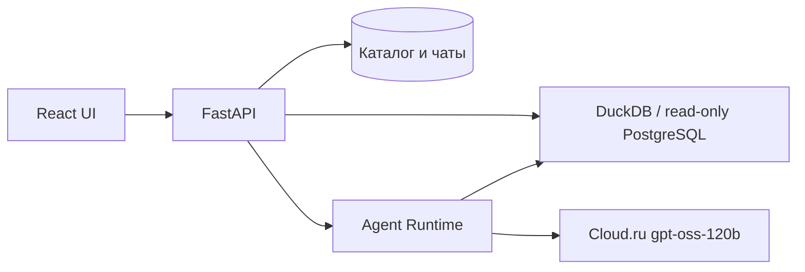

# EVIA: сценарий показа и чек-лист релиза 30.10.2026

Это рабочий документ для репетиции, а не заявление о готовности всех задач. Перед
защитой команда отмечает фактический результат каждого шага и заменяет ссылки на
конкретный успешный run/deployment. Конкурсные данные, пароли и ключи не записывать.

## Что показать за 3–4 минуты

1. Открыть [production](https://evia-production.up.railway.app/), войти в тестовый
   аккаунт и убедиться, что список источников доступен. Открыть заранее
   подготовленный синтетический CSV `period,revenue,segment` со строками
   `2026-01,100,A`, `2026-02,200,B`, `2026-03,300,A`. Не использовать личные данные.
2. Во вкладках источника показать поля, качество и первые строки. Спросить
   «Какие есть столбцы?» и «Что передо мной?». Эти два ответа берутся из
   проверенных schema/profile без вызова модели; показать, что названия полей
   совпадают с загруженным файлом.
3. Спросить «Какая сумма revenue?». Проверить **600** в ответе и открыть
   результаты/паспорт: SQL, источник, snapshot, охват, ограничение строк.
   Если модель ошиблась, показать ошибку честно и перейти к заранее сохранённому
   результату; не выдавать неподтверждённый текст за расчёт.
4. Показать график и сохранённый дашборд: открыть его из галереи, обновить,
   поменять порядок двух карточек, перезагрузить страницу и открыть прямую
   ссылку `?dashboard=<ID>`. Для нового отчёта проверить кнопку исходного чата.
5. Если демонстрационная PostgreSQL-таблица заранее разрешена в настройках
   сервиса, открыть экран подключения, выбрать таблицу и задать один простой
   вопрос. Не вводить пароль в браузере и не обещать самостоятельную настройку
   произвольного PostgreSQL: сейчас она делается через переменные сервиса (#24).

Не демонстрировать как гарантированные возможности: произвольный сложный
text-to-SQL, выводы о причинности, автономный offline runtime, создание каждого
вида дашборда по первой попытке. Их статус зависит от открытых задач ниже.

## Рабочая матрица технических требований

Это группировка по текущему backlog, **не официальная нумерация конкурсного
задания**. Капитан сверяет формулировки с исходным документом до защиты.

| Область | Issue | Проверка перед показом | Шаг |
| --- | --- | --- | --- |
| Импорт CSV и исходные значения | #7 | import report, повторный импорт, синтетический файл | 1 |
| Прямой read-only PostgreSQL | #23, #24 | разрешённая таблица и статус соединения | 5 |
| Неизвестная схема | #8, #22 | реальные имена и типы полей, отсутствие выдумок | 2 |
| Безопасное выполнение SQL | #9, #12 | только SELECT, отклонение изменения данных | 3 |
| Вычисленный ответ | #13, #75, #125 | сумма 600 с результатом инструмента; #125 открыт | 3 |
| Группировки и диагностика | #25 | один заранее проверенный пример | 2–3 |
| Графики | #26, #27 | карточка строится по возвращённым данным | 4 |
| Дашборд и восстановление | #28, #30 | reload, порядок, refresh, исходный чат; #28 открыт | 4 |
| История и изоляция чатов | #16, #18, #76 | повторное открытие и другой аккаунт | 1, 4 |
| Понятный UI и доступность | #56, #66, #31, #35 | 390 px, клавиатура, пустые/error состояния; #35 открыт | весь показ |
| Развёртывание и производительность | #51, #74, #14, #34 | `/health`, deployment SHA, p95 из #74; #14/#34 открыты | перед показом |

## Архитектура и цифры для презентации

- CSV хранится как versioned snapshot; запросы к данным проходят через
  ограниченный read-only SQL executor. Дашборды хранят определения графиков
  и пересчитываются при обновлении.
- [Воспроизводимый замер #74](https://github.com/VsevolodCod/EVIA/issues/74#issuecomment-6497065269)
  на Railway/Cloud.ru: schema p95 **62 мс** (30 повторов), overview **134 мс**
  (30), SQL-сумма **6093 мс** (5); это серверное время, без браузерной сети.
  Сравнение двух моделей и универсальный SLA не заявлены (#14).
- Ограничения: нестабильные вопросы общего агента (#125), создание осмысленного
  дашборда по произвольному запросу (#29), версионирование бизнес-метрик (#19),
  долгие операции (#32), автономная поставка (#34).
- В слайд о команде вписать **проверенный вклад каждого участника по PR**, а не
  угадывать его по авторству коммитов. В слайд о сроках — согласованный регламент
  защиты; дата из переписки не заменяет официальное расписание.

## Перед выходом на защиту

- [ ] Записать `git rev-parse origin/main`, ID production deployment и URL CI run;
  убедиться, что код в Railway совпадает с `main` и `/health` отвечает 200.
- [ ] Пройти шаги 1–5 на отдельном тестовом аккаунте без конкурсных данных;
  зафиксировать результат и screenshot/короткую резервную запись. Запись
  дополняет, но не заменяет живой показ.
- [ ] Проверить авторизацию, восстановление пароля и что другой аккаунт не
  видит источники/чаты/отчёты тестового пользователя.
- [ ] Проверить мобильную ширину 390 px, клавиатурную навигацию, контраст,
  reduced motion и ошибку Cloud.ru. Непроверенное пометить как ограничение.
- [ ] Убедиться, что Railway volume имеет запас места; экспорт/повторный импорт
  не должны упираться в заполненный том.
- [ ] Проверить зависимости и лицензии перед распространением. В репозитории
  сейчас нет корневого `LICENSE`; решение о лицензии проекта остаётся за командой.
- [ ] Согласовать с капитаном вклад участников, порядок выступлений, длительность,
  формат резервной записи и официальные сроки.

Для репетиции не запускать модель на ноутбуке владельца: рабочий стенд — Railway.
