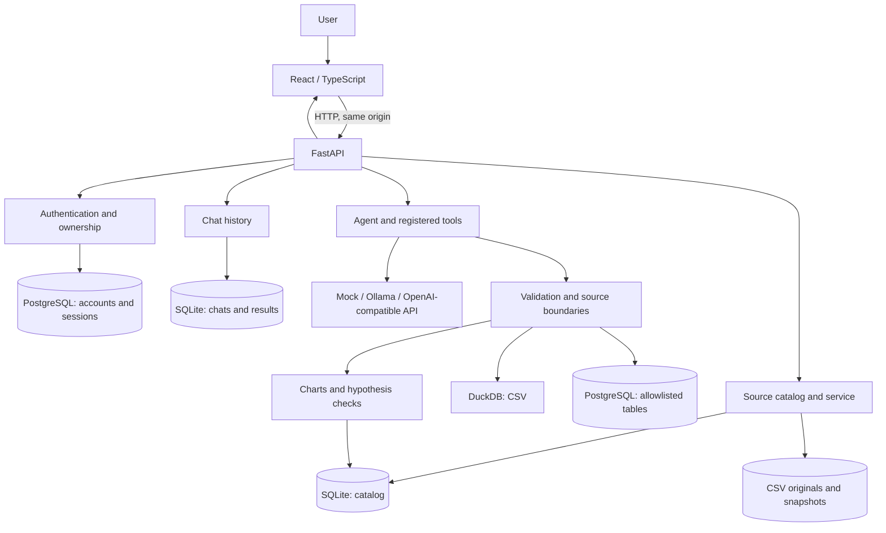

# EVIA architecture

[English README](../../README.en.md) · [Русский](ARCHITECTURE.md) · [Expert guide](EXPERT_GUIDE.en.md)

This document describes the repository implementation. It does not promise that every scenario succeeds for every source or deployment.

## Components

| Layer | Location | Responsibility |
| --- | --- | --- |
| UI | `frontend/src/` | Workspace, CSV upload, profile, chat, cards, PDF and account state. |
| API | `app/main.py`, `app/auth_routes.py` | HTTP routes, validation, authentication and service calls. |
| Accounts | `app/auth.py`, `app/ownership.py` | Accounts, password hashing, sessions and owner checks. PostgreSQL is required when authentication is enabled. |
| Sources | `app/source_service.py`, `app/csv_import.py`, `app/data_sources/` | CSV import and snapshots, schema, profile and access to configured PostgreSQL tables. |
| Storage | `app/schema_catalog.py`, `app/chat_manager.py`, `BI_DATA_DIR` | SQLite catalog and history, source files in persistent storage. Configuration and backups depend on deployment. |
| Agent and LLM | `app/agent.py`, `app/llm/`, `app/tools/` | Conversation context, model calls and a bounded tool set. |
| Execution | `app/safe_sql.py`, `app/data_engine.py`, `app/postgresql_sql.py` | Query validation and read-only calculations against the selected source. |
| Artifacts | `app/charts/`, `app/hypothesis/` | Chart specifications, card execution, saved results and hypothesis checks. |

## Data flow

1. **Identity and access.** When authentication is enabled, the backend identifies the user through a server session and checks ownership. Passwords are stored as Argon2 hashes. Recovery requires configured email delivery.
2. **Source connection.** CSV is validated and saved with a snapshot and schema. PostgreSQL uses a preconfigured DSN and table allowlist; credentials are not entered into chat.
3. **Profiling.** The service returns schema, preview and statistics. Full and sampled profiles have different scope. Some figures currently treat empty strings and `NULL` differently ([#152](https://github.com/VsevolodCod/EVIA/issues/152)).
4. **Question.** Chat sends the question, selected source and history. The agent may use an LLM and permitted tools. Model and step limit are configured by deployment; local `mock` does not establish real LLM quality.
5. **Execution.** CSV uses validated, bounded read-only SQL through DuckDB. PostgreSQL uses a validated query against an allowlisted table in a read-only transaction. The server returns data or a structured error.
6. **Display and persistence.** The UI displays the answer and available artifacts. History stores the returned response; dashboards can store chart definitions and computed snapshots. Reopening and refreshing are separate operations.
7. **Export.** The report component composes available schema, profile, first rows and selected answers. The browser creates a PDF through its print dialog; the source chart uses preview data.

## API

| Route | Purpose |
| --- | --- |
| `GET /health` | Application status and configured provider type. |
| `POST /auth/register`, `/auth/login`, `/auth/logout` | Registration, login and logout when authentication is enabled. |
| `GET /auth/me`, `PATCH /auth/profile`, `/auth/avatar` | Account, profile and photo. |
| `POST /auth/reset/request`, `/auth/reset/confirm` | Request and apply a recovery code when delivery is configured. |
| `POST /sources/csv`, `GET /sources` | Upload CSV and list accessible sources. |
| `GET /sources/{id}/schema`, `/preview`, `/profile` | Schema, bounded preview and profile. |
| `POST /agent/ask`, `POST /agent/chat` | Standalone question or a question in a conversation. |
| `GET /chats`, `POST /chats`, `GET /chats/{id}` | Create and restore conversation history. |
| `GET /dashboards/ids`, `GET /dashboards/{id}/build`, `POST /dashboards/{id}/refresh` | List, saved result and explicit dashboard refresh. |

See [contracts](../../contracts/README.md); a running FastAPI server exposes interactive documentation at `/docs`. The `/auth/avatar` path supports multiple HTTP methods.

## Model, storage and deployment

`LLM_PROVIDER` selects `mock`, `ollama` or `openai`; `LLM_MODEL`, the API address and provider secret are environment settings. An OpenAI-compatible Cloud.ru setup needs the appropriate server-side `OPENAI_BASE_URL` and key. Do not hard-code a current model, DSN or secret: deployment configuration can change.

CSV and history need persistent disk storage; the account PostgreSQL service also needs persistent storage and backups. On Railway, EVIA can use a volume and a PostgreSQL service. [Account setup](../ACCOUNT_SETUP.md) and [PostgreSQL source setup](../postgresql-source.md) describe their different roles (Russian).

## Reliability boundaries

- Read-only validation and database privileges complement each other; neither replaces application access control.
- Sampling, result and execution limits mean visible rows or charts may cover only part of a dataset.
- CSV chart snapshots are tied to source versions; changed PostgreSQL rows may not automatically mark a result stale.
- Dashboard generation and complex text-to-SQL depend on the model and input. A failed tool call is not a successful calculation.
- Check actual CI results. During documentation preparation, frontend and browser jobs passed while backend had 16 failures; see the [CI run](https://github.com/VsevolodCod/EVIA/actions/runs/41166332811).

## Further reading

[SQL executor](../safe-sql-executor.md) · [Analysis history](../analysis-history.md) · [Dashboard snapshots](../saved-dashboard-snapshots.md) · [Chart contracts](../charts-agent-contract.md) · [Hypotheses](../hypothesis_overview.md) (Russian). Historical documents describe their publication date; check current code when they differ.
