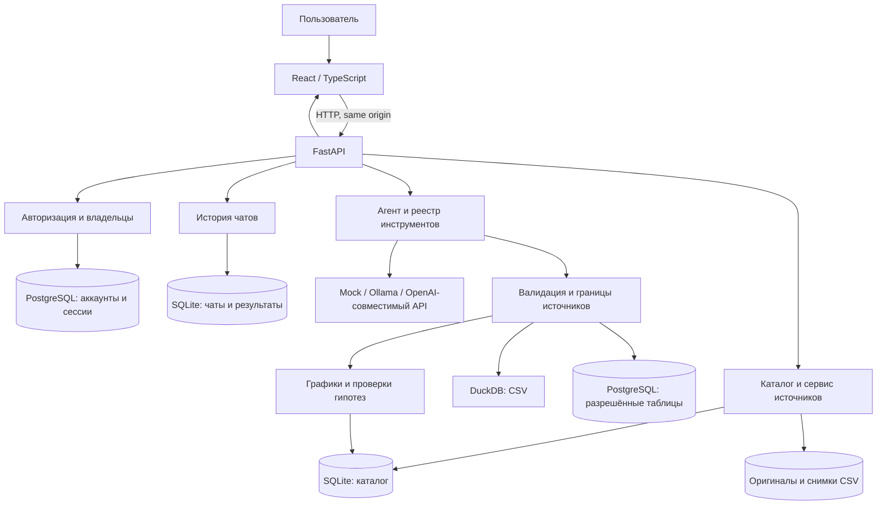

# Архитектура EVIA

[README](../../README.md) · [English](ARCHITECTURE.en.md) · [Руководство эксперта](EXPERT_GUIDE.md)

Документ описывает реализацию репозитория, а не обещание, что каждый сценарий успешно работает на любом источнике или развёртывании.

## Компоненты

| Слой | Расположение | Ответственность |
| --- | --- | --- |
| Интерфейс | `frontend/src/` | Рабочая область, загрузка CSV, профиль, чат, карточки, PDF и состояние аккаунта. |
| API | `app/main.py`, `app/auth_routes.py` | HTTP-маршруты, проверка входных данных, авторизация и вызов сервисов. |
| Учётные записи | `app/auth.py`, `app/ownership.py` | Аккаунты, хеширование паролей, сессии и проверки владельца. При включённой авторизации требуется PostgreSQL. |
| Источники | `app/source_service.py`, `app/csv_import.py`, `app/data_sources/` | Импорт и снимки CSV, схема, профиль и доступ к настроенным PostgreSQL-таблицам. |
| Хранение | `app/schema_catalog.py`, `app/chat_manager.py`, `BI_DATA_DIR` | Каталог и история в SQLite, файлы источников в постоянном каталоге. Настройки и backup зависят от установки. |
| Агент и LLM | `app/agent.py`, `app/llm/`, `app/tools/` | Контекст диалога, обращения к модели и ограниченный набор инструментов. |
| Вычисления | `app/safe_sql.py`, `app/data_engine.py`, `app/postgresql_sql.py` | Проверка запросов, чтение и вычисления по данным выбранного источника. |
| Аналитические артефакты | `app/charts/`, `app/hypothesis/` | Схемы графиков, исполнение карточек, сохранённые результаты и проверки гипотез. |

## Поток данных

1. **Регистрация и доступ.** При включённой авторизации backend устанавливает пользователя по серверной сессии и проверяет владение доступными данными. Пароль хранится в виде Argon2-хеша. Восстановление требует настроенного почтового сервиса.
2. **Подключение источника.** CSV валидируется и сохраняется как источник со снимком и схемой. PostgreSQL использует заранее настроенный DSN и allowlist таблиц; креденшалы не вводятся в чат.
3. **Профилирование.** Сервис возвращает схему, предпросмотр и статистику. Полный профиль и профиль выборки отличаются по охвату. Пустые строки и `NULL` в некоторых показателях пока учитываются по-разному ([#152](https://github.com/VsevolodCod/EVIA/issues/152)).
4. **Вопрос.** Чат передаёт вопрос, выбранный источник и историю. Агент может использовать LLM и разрешённые инструменты. Модель и число шагов определяются настройками; локальный `mock` не подтверждает качество реальной LLM.
5. **Расчёт.** Для CSV применяется ограниченный read-only SQL через DuckDB; для PostgreSQL — проверенный запрос к разрешённой таблице в read-only транзакции. Сервер возвращает результат или структурированную ошибку.
6. **Отображение и сохранение.** UI показывает ответ и доступные артефакты. История сохраняет результат ответа; дашборд может хранить определения и рассчитанные снимки графиков. Повторное открытие и явное обновление — разные операции.
7. **Экспорт.** Компонент PDF собирает документ из доступной схемы, профиля, первых строк и выбранных ответов. PDF создаёт браузер через диалог печати; диаграмма источника использует предпросмотр.

## API

| Маршрут | Назначение |
| --- | --- |
| `GET /health` | Состояние приложения и имя настроенного типа провайдера. |
| `POST /auth/register`, `/auth/login`, `/auth/logout` | Регистрация, вход и выход при включённой авторизации. |
| `GET /auth/me`, `PATCH /auth/profile`, `/auth/avatar` | Учётная запись, профиль и фото. |
| `POST /auth/reset/request`, `/auth/reset/confirm` | Запрос и применение кода восстановления при настроенной доставке. |
| `POST /sources/csv`, `GET /sources` | Загрузка CSV и список доступных источников. |
| `GET /sources/{id}/schema`, `/preview`, `/profile` | Схема, ограниченный предпросмотр и профиль. |
| `POST /agent/ask`, `POST /agent/chat` | Отдельный вопрос или вопрос в чате. |
| `GET /chats`, `POST /chats`, `GET /chats/{id}` | Создание и восстановление истории. |
| `GET /dashboards/ids`, `GET /dashboards/{id}/build`, `POST /dashboards/{id}/refresh` | Список, сохранённый результат и явный перерасчёт дашборда. |

Схемы и примеры: [контракты](../../contracts/README.md); интерактивная спецификация FastAPI доступна на `/docs` работающего сервера. Разные пути `/auth/avatar` используют разные HTTP-методы.

## Модель, хранилище и развёртывание

`LLM_PROVIDER` выбирает `mock`, `ollama` или `openai`; `LLM_MODEL`, адрес API и секрет провайдера задаются окружением. Для OpenAI-совместимого Cloud.ru нужен соответствующий серверный `OPENAI_BASE_URL` и ключ. Не зашивайте текущую модель, DSN или ключ в исходный код: конфигурация может меняться.

CSV и история должны сохраняться на постоянном диске, а PostgreSQL аккаунтов — иметь отдельное постоянное хранилище и резервное копирование. На Railway сервис EVIA может использовать volume и PostgreSQL-сервис. [Настройка аккаунтов](../ACCOUNT_SETUP.md) и [настройка PostgreSQL-источника](../postgresql-source.md) описывают различные роли этих хранилищ.

## Границы надёжности

- Ограничение read-only и права пользователя БД дополняют друг друга; они не заменяют контроль доступа к самому приложению.
- Лимиты выборки, результата и времени означают, что видимые строки или график могут отражать не полный набор.
- Снимок графика на CSV связан с версией источника; для изменившихся строк PostgreSQL автоматическое обнаружение устаревания не гарантируется.
- Построение дашборда и сложный text-to-SQL зависят от модели и входных данных. Ошибка инструмента не должна считаться успешным расчётом.
- Состояние автоматических тестов проверяется по фактическому запуску CI. При подготовке этих материалов браузер и frontend прошли, backend имел 16 падений; подробности — [запуск CI](https://github.com/VsevolodCod/EVIA/actions/runs/41166332811).

## Исходные материалы

[Безопасный SQL](../safe-sql-executor.md) · [История анализа](../analysis-history.md) · [Снимки дашбордов](../saved-dashboard-snapshots.md) · [Модели графиков](../charts-agent-contract.md) · [Проверки гипотез](../hypothesis_overview.md). Некоторые исторические документы отражают состояние на дату написания; при расхождениях сверяйте актуальный код.
