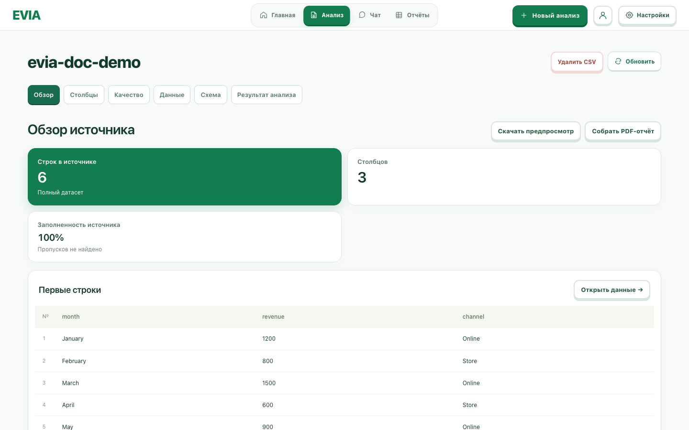

# Удаление загруженного CSV

Если в хранилище не хватает места для нового файла, сначала удалите ненужный CSV-источник. Выберите его в разделе **«Источники данных»** на главной странице и нажмите **«Удалить CSV»** в заголовке источника.

*Фрагмент интерфейса на демонстрационном CSV: кнопка расположена в заголовке выбранного источника.*

После нажатия появится запрос на подтверждение. Удаление необратимо: источник и сохранённые версии его CSV будут удалены из хранилища. Сохранённые отчёты по этому источнику нельзя будет обновить. Перед подтверждением проверьте, что выбран правильный источник.

Когда источник исчезнет из списка, на главной странице нажмите **«Выбрать CSV»** и загрузите новый файл. Кнопка доступна для загруженных CSV; источники PostgreSQL она не удаляет.

Если при удалении сервер сообщает, что ему всё ещё не хватает места для очистки, обратитесь к администратору хранилища.
