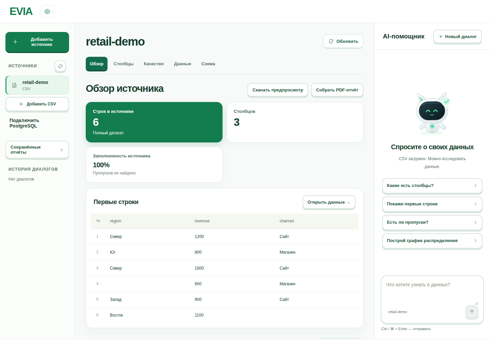
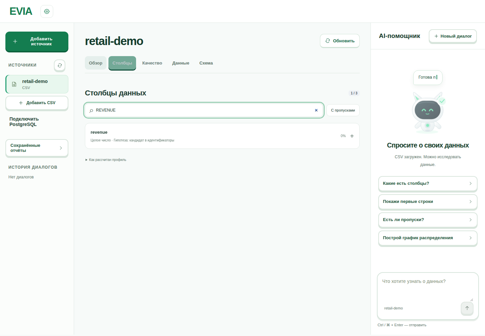
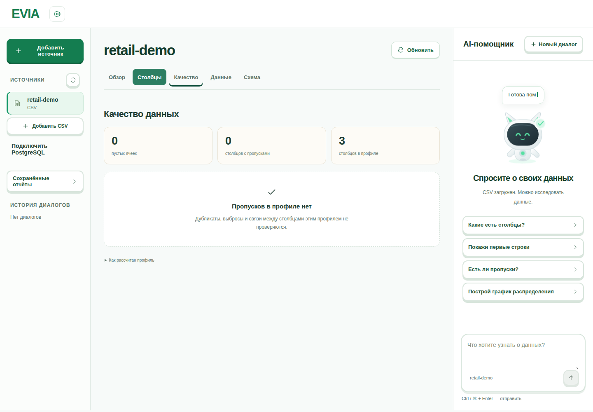
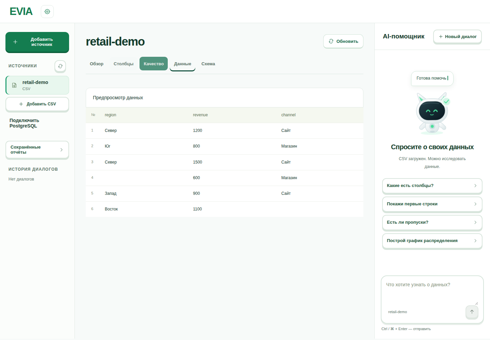
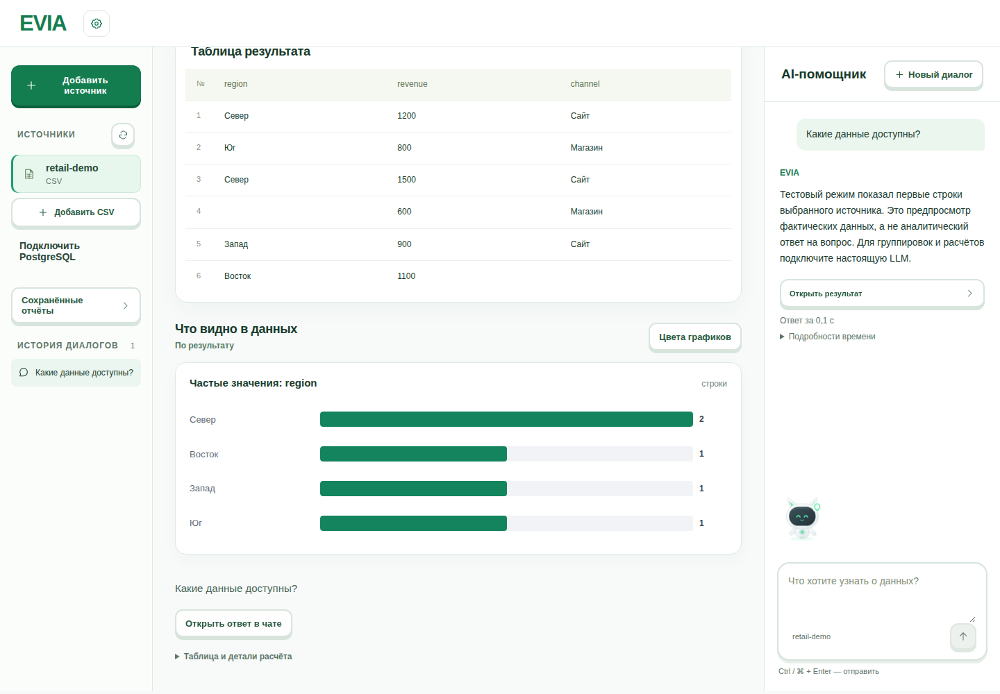
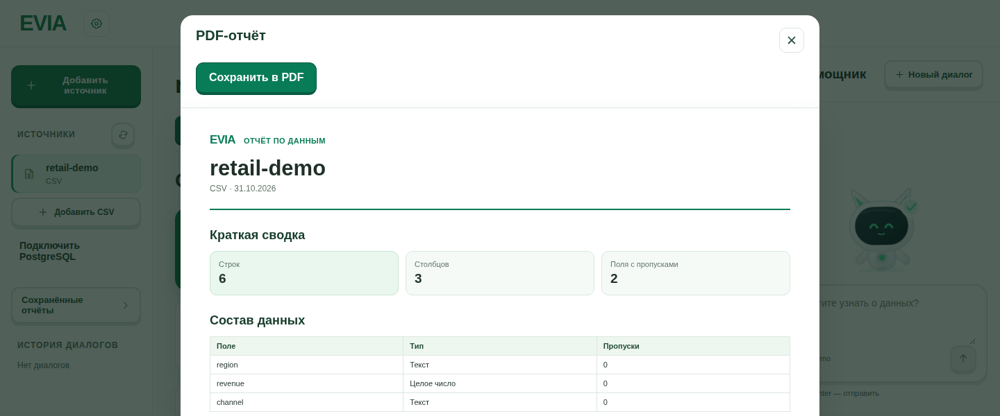
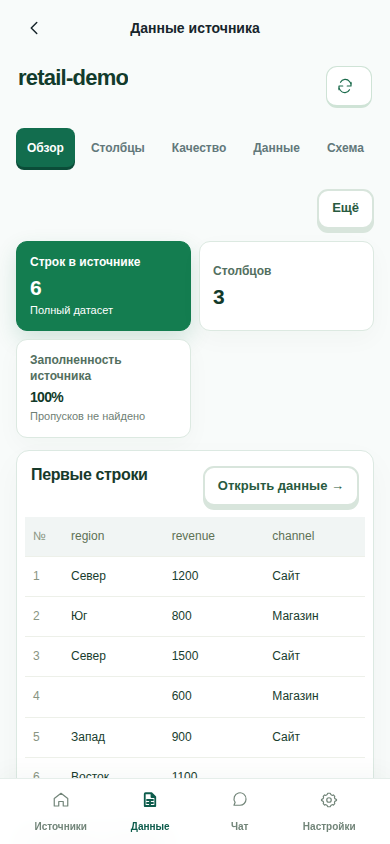
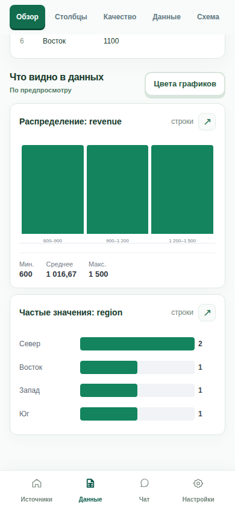

# EVIA — expert walkthrough

[English README](../../README.en.md) · [Русский](EXPERT_GUIDE.md) · [Architecture](ARCHITECTURE.en.md) · [Defense guide](DEFENSE.en.md)

This walkthrough covers the main user scenarios. Screenshots were captured in an isolated browser test using synthetic data. They show the Russian-language UI; layout and controls may differ with screen size, account state and release.

## 1. Preparation

1. Open [EVIA](https://evia-production.up.railway.app/) and register or sign in to a test account.
2. Use a synthetic CSV or [`sample-data/sales.csv`](../../sample-data/sales.csv). Do not use real personal data for a public demonstration.
3. Confirm that the configured model provider is available. A reproducible UTF-8 example is:

```csv
period,revenue,segment
2026-01,100,A
2026-02,200,B
2026-03,300,A
```

The expected `revenue` sum for these three rows is **600**; this is not the sum of `sales.csv`. Check the AI answer against the actual source.

## 2. Upload a CSV

1. Select **«Добавить CSV»** (Add CSV), choose the file or drag it into the upload area.
2. Wait for upload and processing, then select the new source in the sidebar.
3. If import fails, check the file format, unique column names, encoding and available storage. The upload limit is 512 MiB; large files can take time to process.
4. Use the available source replacement action under **«Схема»** (Schema) if needed and inspect import information.



## 3. Explore the source

| Russian tab | What to check |
| --- | --- |
| **Обзор** (Overview) | Row and column counts, key values, first rows and available charts. |
| **Столбцы** (Columns) | Names, inferred types and per-field information. |
| **Качество** (Quality) | Available missing and empty value information; check whether the profile covers the whole source or a sample. |
| **Данные** (Data) | A limited preview, not a complete export of all rows. |
| **Схема** (Schema) | Source structure, version information and available CSV actions. |

<table><tr><td></td><td></td></tr><tr><td>Columns</td><td>Quality</td></tr></table>



## 4. Ask questions and inspect results

1. Select the source and ask **«Какие есть столбцы?»** (Which columns are available?).
2. Ask **«Какая сумма revenue?»** (What is the sum of revenue?). For the three rows above, compare the answer with **600**.
3. Open the answer's result/details. Inspect SQL and returned tables where available, as well as source and scope information.
4. Ask a follow-up in the same conversation. Start a separate chat for another source.
5. On an error or unexpected answer, show the error and retry with exact field names. Do not present uncomputed model text as a verified numerical result.



## 5. Charts and a saved dashboard

Ask for a chart with explicit fields and metric, e.g. **«Построй столбчатый график суммы revenue по period»** (Plot the sum of revenue by period as bars). Verify labels, aggregation and values. Available chart types depend on the data; a pie chart requires suitable nonnegative category shares.

If a dashboard was saved, open **«Сохранённые отчёты»** (Saved reports) in the sidebar. A saved snapshot can be reopened, cards reordered and refresh requested. Refresh recalculates results; on failure the previous saved result remains available. PostgreSQL row changes are not always detected automatically.

## 6. PDF report

1. Open the selected source's **«Обзор»** and choose **«Собрать PDF-отчёт»** (Build PDF report).
2. Select successful Evia answers if available. A basic report is available without them.
3. Review source metrics, fields, first rows, available quality information and selected results. A source distribution chart in this report uses available preview rows.
4. Choose **«Сохранить в PDF»** and save using the browser's print dialog. Review the pages of the resulting file.



## 7. PostgreSQL

An administrator must configure `POSTGRES_DSN` and `POSTGRES_ALLOWED_TABLES` beforehand using read-only permissions. Select an available table and repeat the schema and question walkthrough. The connection screen describes the configured connection; it is not a general browser-based wizard for entering arbitrary database credentials. [Details](../postgresql-source.md) (Russian).

## 8. Account and mobile layout

The profile supports name, photo and password changes. Email recovery requires a configured mail provider. To check isolation, sign in with a separate test account: another user's sources, chats and saved reports should not appear.

<table><tr><td></td><td></td></tr></table>

## 9. Limits to explain

- Answers and dashboard generation depend on the model and are not guaranteed for arbitrary questions.
- Preview charts and row-limited results must not be treated as the entire dataset.
- Correlation and unusual values do not prove causality or a data error.
- Missing-value profiling does not validate every business rule or value.
- Empty strings and `NULL` are currently counted differently in the overview and PDF; quality figures can disagree ([#152](https://github.com/VsevolodCod/EVIA/issues/152)).
- `/health` indicates application availability, not model quality or email delivery.
- CI checks and a live demonstration are different; recheck the current deployment before presenting.
