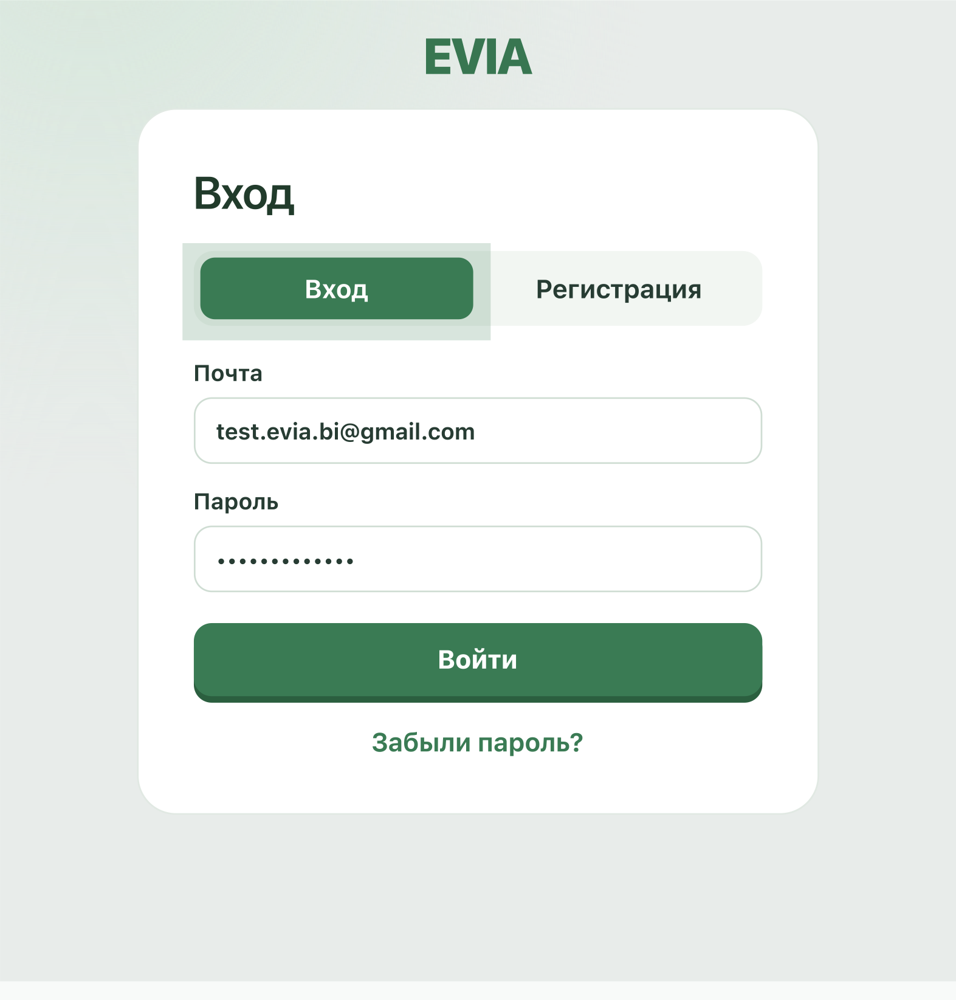

# EVIA — руководство эксперта

[README](../../README.md) · [English](EXPERT_GUIDE.en.md) · [Архитектура](ARCHITECTURE.md)

Руководство помогает пройти основные пользовательские сценарии. Иллюстрации показывают страницу входа и рабочий интерфейс на синтетических данных; внешний вид и набор элементов могут зависеть от размера окна, состояния аккаунта и версии сайта.

## 1. Подготовка и вход

Откройте [EVIA](https://evia-production.up.railway.app/) и войдите в демонстрационный аккаунт:

| Поле | Значение |
| --- | --- |
| Email | `test.evia.bi@gmail.com` |
| Пароль | `!!zk.,k.tle!!` |



*Страница входа в EVIA. Адрес тестового аккаунта виден, пароль замаскирован.*

1. Используйте собственный синтетический CSV либо [`sample-data/sales.csv`](../../sample-data/sales.csv). Не загружайте реальные персональные данные для публичной демонстрации.
2. Проверьте, что провайдер модели доступен. Для воспроизводимого примера можно подготовить CSV:

```csv
period,revenue,segment
2026-01,100,A
2026-02,200,B
2026-03,300,A
```

Для этих трёх строк ожидаемая сумма `revenue` — **600**, а не сумма по файлу `sales.csv`. Сохраняйте файл в UTF-8. Ответ ИИ и содержимое источника проверяйте отдельно.

## 2. Загрузка CSV

1. Нажмите **«Добавить CSV»**, выберите файл или перетащите его в область загрузки.
2. Дождитесь завершения загрузки и обработки. Выберите появившийся источник слева.
3. Если импорт завершился ошибкой, проверьте формат файла, уникальность названий столбцов, кодировку и свободное место. Допустимы файлы до 512 МиБ; обработка больших файлов может занять время.
4. При необходимости в разделе **«Схема»** используйте доступное действие замены данных и изучите сведения об импорте.
5. Если нужно освободить место перед загрузкой другого CSV, удалите ненужный источник кнопкой **«Удалить CSV»**. Подробные шаги и изображение кнопки — в [памятке по очистке CSV](CSV_SOURCE_CLEANUP.md).


## 3. Исследование источника

| Вкладка | Что проверить |
| --- | --- |
| **Обзор** | Количество строк и полей, основные показатели, первые строки и доступные графики. |
| **Столбцы** | Имена, определённые типы и сведения по отдельным полям. |
| **Качество** | Доступные сведения о пропусках и пустых значениях; проверяйте, относится профиль ко всему источнику или к выборке. |
| **Данные** | Предпросмотр строк. Он ограничен и не является полной выгрузкой всего источника. |
| **Схема** | Структура и свойства источника, сведения о версии и доступные действия с CSV. |

<table><tr><td></td><td></td></tr><tr><td>Столбцы</td><td>Качество</td></tr></table>


## 4. Вопросы и результаты

1. Убедитесь, что нужный источник выбран, и введите в чат: **«Какие есть столбцы?»**.
2. Затем спросите **«Какая сумма revenue?»**. Для приведённых выше трёх строк сравните ответ с числом **600**.
3. Откройте результат/детали ответа. Посмотрите SQL и табличные данные, если они возвращены, а также сведения об источнике и ограничениях результата.
4. Задайте уточняющий вопрос в том же диалоге. Для другого источника начните отдельный чат.
5. При ошибке или неожиданном ответе покажите состояние ошибки и повторите запрос с точными именами полей. Не представляйте текст без выполненного расчёта как проверенный численный вывод.


## 5. График и сохранённый дашборд

Попросите график, назвав поля и показатель, например: **«Построй столбчатый график суммы revenue по period»**. Проверьте подписи, агрегат и соответствие значениям. Типы графиков зависят от структуры данных; круговая диаграмма подходит для неотрицательных долей категорий.

Если создан сохранённый дашборд, откройте **«Сохранённые отчёты»** в боковой панели. Сохранённый снимок можно открыть повторно, изменить порядок карточек и запросить обновление. Обновление выполняет перерасчёт; если оно не удалось, прежний сохранённый результат остаётся доступным. Для PostgreSQL автоматическое обнаружение изменения строк не гарантировано.

## 6. PDF-отчёт

1. Откройте **«Обзор»** выбранного источника и нажмите **«Собрать PDF-отчёт»**.
2. Если есть успешные ответы Эвии, выберите нужные. Если ответов нет, базовый отчёт всё равно доступен.
3. Просмотрите состав: показатели источника, поля, первые строки, доступный профиль качества и выбранные результаты. График распределения в этом отчёте строится по доступному предпросмотру.
4. Нажмите **«Сохранить в PDF»** и выберите сохранение в диалоге печати браузера. Проверьте страницы полученного файла.


## 7. PostgreSQL

Попросите администратора заранее настроить `POSTGRES_DSN` и список `POSTGRES_ALLOWED_TABLES` с read-only правами. Выберите доступную таблицу в списке источников и повторите сценарий просмотра схемы и вопроса. Страница подключения показывает состояние заранее настроенного подключения; она не принимает произвольные логины и пароли к БД как универсальный мастер подключения. [Подробнее](../postgresql-source.md).

## 8. Учётная запись и мобильный вид

В профиле доступны имя, фото и смена пароля. Восстановление по email доступно только при настроенном почтовом провайдере. Для проверки изоляции войдите в отдельный тестовый аккаунт: чужие источники, чаты и сохранённые отчёты не должны отображаться.

<table><tr><td></td><td></td></tr></table>

## 9. Что считать ограничением

- Ответы и создание дашбордов зависят от модели и не гарантируют успех для любого запроса.
- Графики из предпросмотра и результаты с ограничением строк не следует трактовать как полный набор.
- Корреляция и подозрительное значение не доказывают причину или ошибку данных.
- Профиль пропусков не проверяет все бизнес-правила и правильность значений.
- Пустые строки и `NULL` сейчас учитываются в обзоре и PDF по-разному; показатели могут расходиться ([#152](https://github.com/VsevolodCod/EVIA/issues/152)).
- `/health` показывает доступность приложения, но не доказывает качество модели или доставку почты.
- Проверки в CI и живая работа приложения — разные вещи; проверяйте актуальное состояние сервиса.
